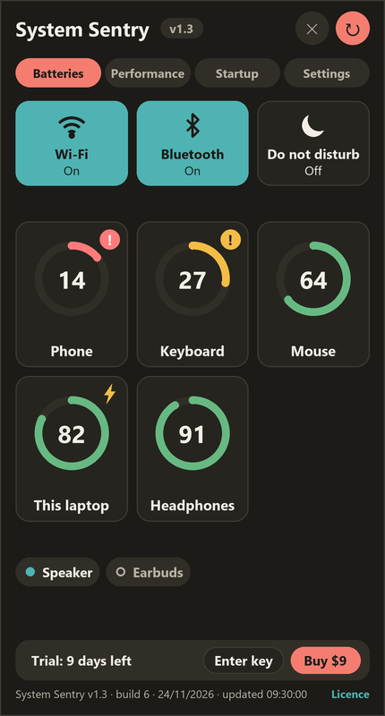
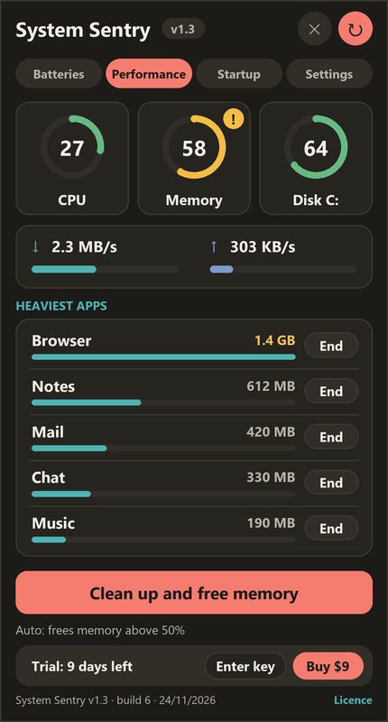
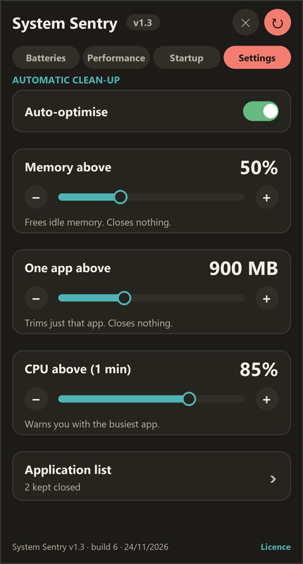
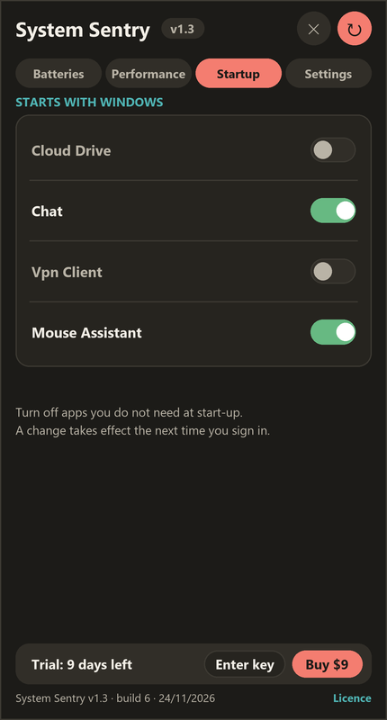
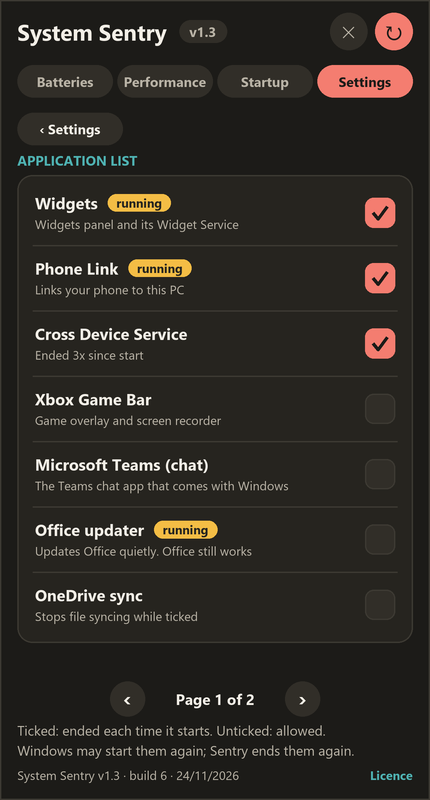
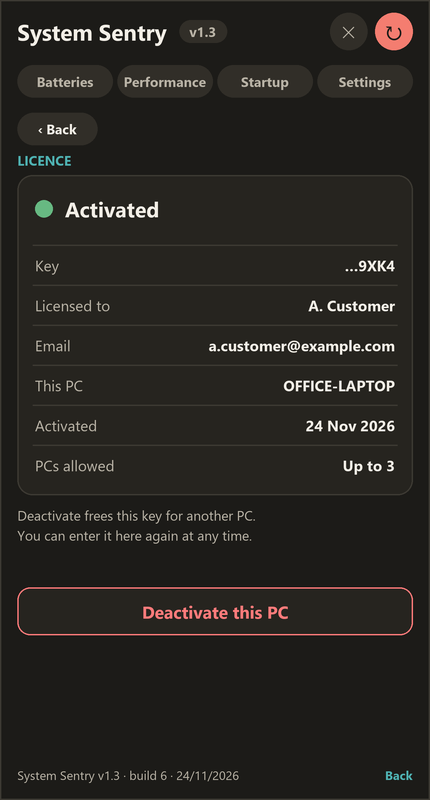
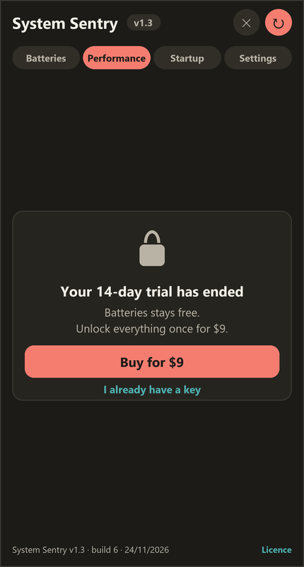

# System Sentry for Windows

See the battery level of every Bluetooth device, keep your PC running smoothly, and clean up in one click. A small tray app for Windows 11.

## Try it free for 14 days

1. Go to **[Releases](../../releases/latest)** and download `SystemSentry-Windows.zip`.
2. Unzip it, open the folder, and double-click `SystemSentry.exe`.
3. Find the icon in your system tray (it may be under the `^` arrow) and click it.

Windows may say it "protected your PC", because the app is new and not yet widely downloaded. Click **More info**, then **Run anyway**.

## What you get

| | Free after the trial | Full version |
| --- | :---: | :---: |
| Battery rings for all your Bluetooth devices and your laptop | Yes | Yes |
| Wi-Fi, Bluetooth and Do not disturb switches | | Yes |
| Live CPU, memory, disk and network | | Yes |
| Heaviest apps with an End button | | Yes |
| One-click clean-up of temporary files and memory | | Yes |
| Automatic memory trimming and CPU warnings (you choose the levels) | | Yes |
| Startup apps on/off | | Yes |
| Application list: tick background apps (Widgets, Phone Link and more) to keep closed | | Yes |

## Buy the full version: $9, once

**[Buy System Sentry - $9](https://buy.polar.sh/polar_cl_ZwDDTx3mIVMecB9yPPVLnD0n4tjBzUP6Q31F00CNd72)**

- One payment. No subscription. Covers all 1.x versions.
- Use it on up to 3 of your PCs.
- You get a licence key straight after paying. In the app, click **Enter key** and paste it.
- Sales tax and VAT are handled for you at checkout.

## Screenshots

 

 

 

## Questions

**Does it send my data anywhere?** No analytics, no tracking. The only internet use is checking your licence key with the payment service (Polar).

**Will it close my apps or delete my files?** Never by itself. Automatic actions only free idle memory. Deleting temporary files or ending an app happens only when you press its button (ending an app asks you to confirm first). The Recycle Bin is never touched.

**Which Windows?** Windows 11. 64-bit.

**I lost my key.** Sign in to your Polar purchase page with the email you paid with and your key is there.

**Support:** kushilov.chowdhury@gmail.com

## Legal

Read the [terms of use](TERMS.md) and the [third-party notices](THIRD-PARTY-NOTICES.md). The source code is private.
